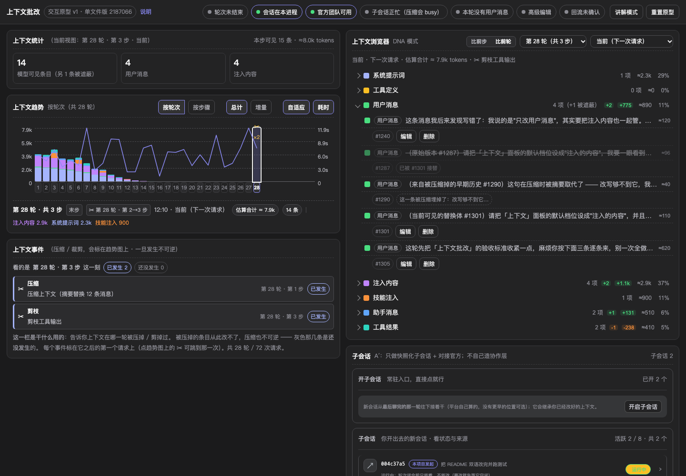
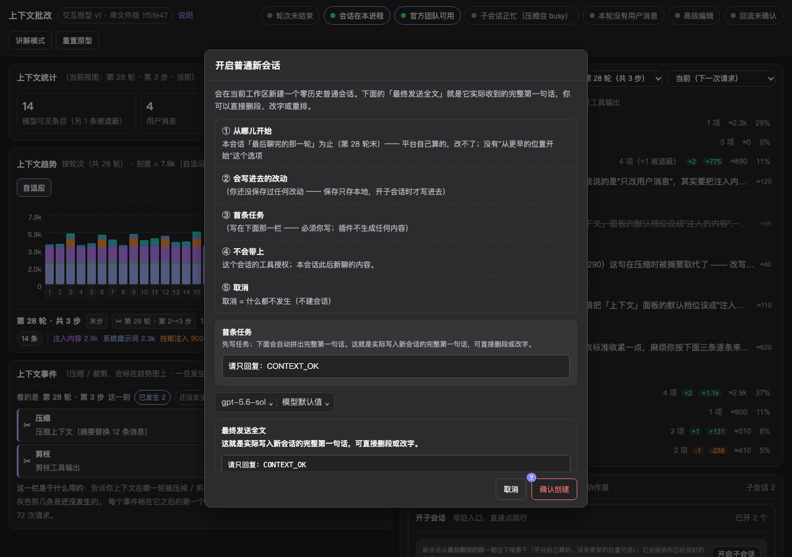
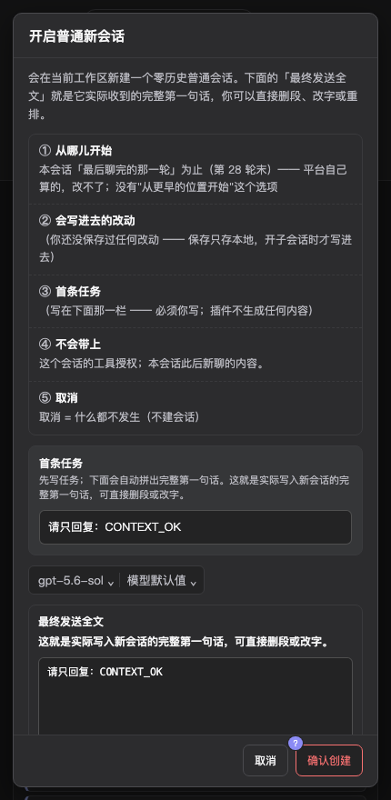

<h1 align="center">Context Redline</h1>

<p align="center">Inspect, redline, and migrate DeepSeek Harness context, then return the bound task result verbatim.</p>

<p align="center">
  <a href="https://www.npmjs.com/package/dsh-context-redline"></a>
  <a href="https://github.com/idoall/dsh-context-redline/actions/workflows/ci.yml"></a>
  <a href="https://github.com/idoall/dsh-context-redline/blob/main/LICENSE"></a>
</p>

<p align="center">English | <a href="https://github.com/idoall/dsh-context-redline/blob/main/README.zh.md">中文</a></p>

<p align="center">
  <a href="#features">Features</a> ·
  <a href="#install">Install</a> ·
  <a href="#usage">Usage</a> ·
  <a href="#boundaries">Boundaries</a> ·
  <a href="https://github.com/idoall/dsh-context-redline/blob/main/CHANGELOG.md">Changelog</a>
</p>

> A DeepSeek Harness community plugin. It does not modify DSH source or rewrite the source session log.
>
> **Version `0.8.2` — supports DSH `>=0.2.2-rc.5 <0.3.0-0`.** Built and regression-tested against `0.2.2-rc.5`; Node.js `>=24.9.0` is required. DSH `0.3.0` prereleases are excluded.

Edits stay local until confirmation. The plugin then opens a zero-history ordinary session in the current workspace and sends the exact final message you approved. When the task finishes, its bound result returns verbatim to the source session.

<p align="center">
  
</p>

<p align="center"><sub>Current interactive demo, desktop: context scale and events on the left; review, edit, delete, and carrier controls on the right.</sub></p>

## Features

- **Full durable text.** Editors read the complete event body, never the shortened list preview.
- **Local redlining.** Edit user messages, injected/skill material, assistant migration copies, and paired tool results.
- **Reversible deletion.** Delete means “do not migrate this identity”; the source log remains append-only.
- **Authoritative final message.** The confirmation textarea is the exact first user message written to the new session.
- **Handoff skill.** The plugin contributes a runtime skill, `context-redline-handoff`: it reads the current conversation and outputs both handoff shapes — the migration fields (first task + per-request rule anchor) and the anchored conversation fields (first task, goal, acceptance criteria, discipline), with mandatory task decomposition, role separation, and conditional headed UAT.
- **Anchored conversation without migration.** Starts an independent root conversation from a task plus a frozen runtime snapshot of goal, acceptance criteria and discipline. Nothing is copied from the current session and no result is returned to it.
- **DNA fingerprint mode.** The trend bars can switch to a per-item gradient in the model’s read order; the browser’s DNA switch and the trend switch move together. DNA currently forces total semantics.
- **Trend duration overlay.** Each trend bar carries its step’s active time as a curve read off the right-hand axis; turn mode sums the turn’s steps. The Adaptive and Duration modifiers share one compact toggle group, and the old focused-category subtitle is gone.
- **Anchor with two modes.** An optional short anchor, written by you, can be repeated at the start and end of the first message, or supplied as a per-request runtime rule. The runtime mode uses DSH's runtime-context snapshot: unchanged text is not rewritten, and after compaction it is re-declared with a supersession notice. Neither mode touches the preset-owned system prompt or the source session.
- **Per-session model selection.** A compact floating picker configures only the carrier Agent and never changes the source/global default.
- **Ordinary zero-history session.** The carrier is a root session in the current workspace, not inherited fork history.
- **Automatic verbatim return.** Only the result bound to the fixed prompt request is returned.
- **Crash recovery.** Fixed IDs, strict ledgers, exact-content matching, flush, cold reads, and three-state recovery prevent guessing and duplicate sends.

<p align="center">
  
</p>

<p align="center"><sub>Desktop confirmation: task, model/effort, and the final message freeze in one explicit authorization.</sub></p>

<p align="center">
  
</p>

<p align="center"><sub>Mobile confirmation: model and effort stay on one row; long content scrolls inside the final-message editor.</sub></p>

> Screenshots come from the current interactive demo and illustrate layout and the product flow; they are not presented as production session data.

## Install

Requires DeepSeek Harness `0.2.2-rc.5` or a newer supported `0.2.x`, plus Node.js `24.9+`. Older DSH installations should stay on plugin `0.1.2` until upgrading DSH.

Install or upgrade to this exact release:

```sh
dsh plugin --profile web add dsh-context-redline@0.8.2
```

This patch fixes the DNA switch state: opening DNA from the Context browser now also parks the trend at Total, so the Delta segment no longer looks selected while the chart plots total. It keeps the trend DNA mode, duration overlay, anchored conversation, both anchor modes and the DSH 0.2.2-rc.5 compatibility fixes. The runtime rule is opt-in, shown verbatim in confirmation, frozen in the ledger, and registered through `systemPrompt.context` for the carrier only; it is not a preset system prompt or a hidden injection. Unaccepted diagnostics and carrier-seed experiments are not included. Automated tests do not constitute production visual or real-session acceptance.

Local development:

```sh
pnpm install
pnpm run build
dsh plugin --profile web add "link:$(pwd)"
```

The user must restart `dsh web` after installation or Host changes. A rebuilt Client-only change normally needs only a hard refresh.

Remove:

```sh
dsh plugin --profile web remove dsh-context-redline
```

Uninstalling does not automatically delete local drafts and operation ledgers under `$DSH_HOME/dsh-context-redline/`.

## Usage

1. Open a session with messages and select **Context Redline**.
2. Optionally edit/delete individual items; saves remain local.
3. Choose **Open ordinary new session**.
4. If you are not sure what to fill, run the `context-redline-handoff` skill first; it recommends migration or a fresh anchored conversation and outputs the matching fields. The snapshot is frozen before creation and re-declared after compaction.
5. In the migration flow, enter the task; optionally add a short anchor (keywords or hard constraints) and choose **first message** or **runtime rule**, then finish the exact final message.
6. Choose a model; keep effort at **Use model default** unless needed.
7. Confirm creation and open the new session from the left sidebar.
8. In the migration flow, the bound result returns automatically after completion.

See the [user guide](https://github.com/idoall/dsh-context-redline/blob/main/docs/12-user-guide.md).

## Images and attachments

- Mixed text/image messages migrate all text and report omitted images.
- Pure-image messages do not create fabricated empty paragraphs.
- Image identities remain in the source fingerprint, so changes invalidate confirmation.
- Image binaries, files, file refs, and generic attachments are not migrated yet; unknown media refuses instead of disappearing silently.

## Boundaries

- Never rewrites or deletes source history.
- System prompts and tool schemas come from the target preset; migrated prose never pretends to alter those layers.
- Tool results require a matching call identity.
- No history/version UI, rollback, compaction, team task board, or session deletion UI.
- The plugin provides lock-scoped idempotence and recovery; it does not claim platform-native exactly-once delivery.

## Development

```sh
pnpm install
pnpm run typecheck
pnpm run lint
pnpm run test
./node_modules/.bin/vitest run
node scripts/release-check.mjs
pnpm pack --dry-run
```

Pushing a `v*` tag runs the version and bilingual-release-note gate, tests, package creation, npm Trusted Publishing over OIDC (no `NPM_TOKEN`), and GitHub Release creation.

## Documentation

- [User guide](https://github.com/idoall/dsh-context-redline/blob/main/docs/12-user-guide.md)
- [Context migration contract](https://github.com/idoall/dsh-context-redline/blob/main/docs/13-context-migration.md)
- [System prompt and injection boundaries](https://github.com/idoall/dsh-context-redline/blob/main/docs/14-system-prompt-and-injection.md)
- [Carrier lifecycle](https://github.com/idoall/dsh-context-redline/blob/main/docs/15-carrier-lifecycle.md)
- [Upstream provenance and modifications](https://github.com/idoall/dsh-context-redline/blob/main/UPSTREAM.md)

## License

Original work is MIT; portions copied from `dsh-context` remain Apache-2.0. See [LICENSE](https://github.com/idoall/dsh-context-redline/blob/main/LICENSE), [LICENSE-Apache-2.0](https://github.com/idoall/dsh-context-redline/blob/main/LICENSE-Apache-2.0), [NOTICE](https://github.com/idoall/dsh-context-redline/blob/main/NOTICE), and [UPSTREAM.md](https://github.com/idoall/dsh-context-redline/blob/main/UPSTREAM.md). This is an independent fork and is not endorsed by the upstream author.
