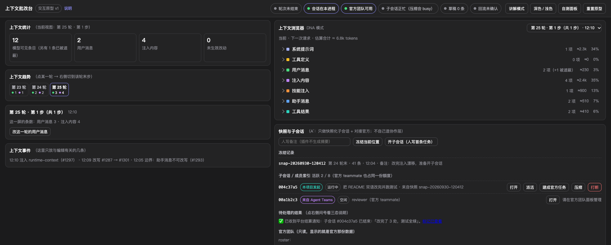

# dsh-context-redline (Context Redline)

> A **DeepSeek Harness plugin** that turns the context panel from a **read-only dashboard** into a
> **workbench a human can redline**: read what the model is about to receive, edit one item, keep the
> edit **local to the plugin**, and — when you open a child session — carry those edits **verbatim into
> the first message** of that new session.

**Status: M1 landed in-repo (skeleton + identity), not yet installed into a profile.** The context shell is
copied from upstream [`dsh-context`](https://github.com/bowenliang123/dsh-context) at git tag **`v0.59.2`** and renamed
into our own namespaces; the editing layer (M2) and the UI wiring (M3) are next. The clickable prototype that
defines the interface is [`demo/`](demo/README.md) — **it is the standard** if any document disagrees.

---

## What it solves

| Problem | Symptom | Answer |
|---|---|---|
| **Context bloat** | every request resends the whole history; sessions grow without bound | **Open a child session**: it inherits the *completed* history (then **explicit compaction** is what actually shortens it) |
| **A wrong item keeps steering the model** | you said one thing badly and everything after it went sideways | **Edit that item**, save it locally, then **open a child session** — your edits go into its first message verbatim |
| **Nothing is editable** | the upstream context browser can only be read | **Edit on the right**: which item, what you changed, and where the change goes are always visible on the row |

**In one line**: read the context → edit one item → save (local only) → open a child session with the edited context.

## What it looks like


> ⚠️ This image is from the repository's **interactive demo** (`demo/`, dark theme) — the
> **current interface standard** the plugin is built to match. **Plugin screenshots cannot be
> given yet**: they need a real panel capture after `dsh web` is restarted (the human gate
> `docs/10` M3-22). Presenting a demo capture as a plugin capture is the one easy misreading
> here, so it is called out.

Five cards, in two columns ([`demo/`](demo/README.md) is the authority):

- **Left**: context stats · context trend (per turn / per step, total / delta, adaptive scale) · context events.
- **Right**: the context browser (7 categories, counts / ≈tokens / share / non-zero δ per row) · child sessions.
- **On a row**: `#seq`, the category, a preview — and **`Edit`**, the only action. Rows the platform cannot rewrite
  (assistant messages, compacted-away rows, shadowed originals) carry **a one-line reason and no action at all**.
- **The editor** expands **inline under that row** (never a modal) and is prefilled with the **full text** — never the
  80-character list preview (that mistake destroyed a message in the earlier attempt; see [`docs/01`](docs/01-platform-facts.md) F35).
- **Every save is temporary** (hard constraint). It is written to the plugin's local store only, so the **current**
  session's model never sees it. Rows with a local edit show `已改（本地）` plus `丢弃这条改动`; clicking `Edit` again
  prefills what you last saved, and saving **overwrites that same local edit** (it does not stack).
- **The only write point is `开启子会话`**: its confirmation lists the local edits, and on confirm they are written
  **verbatim into the new session's first message**. A child session always starts at the parent's **last completed
  turn** — there is **no parameter** to pick an earlier cut point ([`docs/01`](docs/01-platform-facts.md) F38).

## Four rules to grasp at a glance

1. Only what is **on the surface** reaches the model.
2. **Saving is not applying.** A save never touches the session log; the current model's view does not change.
   The single write point is opening a child session.
3. **What is editable is decided by the platform, not by preference** (measured):
   - Editable: **user messages, injected content, skill injection, tool results**.
   - **Not editable: assistant messages** (two platform rules are mutually exclusive) and **system prompts**;
     **shadowed originals** and **compacted-away rows** are not editable either.
   - Every one of those row types gets **a stated reason and no action**, never a button that will fail.
4. This UI offers **no** version history, rollback, annotate, pinned blocks, drift check, re-injection, compaction,
   dispatch or team operations. Editing is the one action, and it is **one step** (save locally).

## Explicitly out of scope

- ❌ No "delete history" (the DSH session log is append-only; only **shadowing** and **compaction** exist — the latter irreversible).
- ❌ No auto-fork, no auto-compaction, no auto-apply of local edits.
- ❌ No **AI-generated content** anywhere. This is the project's reason to exist: every character that reaches the model is human-written.
- ❌ No "context assembly / templates / extends" layer in this round (a different data model — see [`docs/00`](docs/00-scope.md) §4).

---

## Documentation index

| File | Content |
|---|---|
| [`docs/00-scope.md`](docs/00-scope.md) | Goals / non-goals / user stories / **acceptance criteria** / glossary |
| [`docs/01-platform-facts.md`](docs/01-platform-facts.md) | **Platform facts**, each with a source and a `measured` / `inferred` tag, plus open verification items |
| [`docs/02-architecture.md`](docs/02-architecture.md) | Five layers, two data flows, module layout, RPC / command / service surface, storage |
| [`docs/03-ui-spec.md`](docs/03-ui-spec.md) | **UI spec**, numbered requirements, exact copy, acceptance checklist, explicit non-goals |
| [`docs/04-roadmap.md`](docs/04-roadmap.md) | Stages M0–M7 (deliverables / tests / **who accepts** / **authorization gates**) |
| [`docs/05-test-plan.md`](docs/05-test-plan.md) | Test lanes, real-route test pattern, human-gate checklist, failure-mode cases |
| [`docs/06-orchestration.md`](docs/06-orchestration.md) | Child session / compaction semantics, authorization list, error-code mapping |
| [`docs/08-open-questions.md`](docs/08-open-questions.md) | **Questions and rulings** (each with a recommendation and its final ruling) + the external-model review log |
| [`docs/09-requirements-traceability.md`](docs/09-requirements-traceability.md) | **Requirement traceability**: every original request and every capability from the WeChat screenshots → which goal → done / not done / downgraded |
| [`demo/`](demo/README.md) | **Clickable interaction prototype** (M0.5 gate): fake data, real interactions, and a "what does this button do" explain mode |
| [`docs/12-user-guide.md`](docs/12-user-guide.md) | **User guide**: what this is / five-minute tour / which of the seven kinds can be edited / when editing is blocked / glossary / FAQ |
| [`docs/11-session-handoff.md`](docs/11-session-handoff.md) | **Session handoff**: a copy-paste block plus the fields to refresh at each wrap-up |
| [`docs/10-execution-checklist.md`](docs/10-execution-checklist.md) | **Long-task execution checklist (single source of truth)**: fine-grained table `ID / task / status / frozen file scope`, 269 items; steps needing you are marked `WAIT🙋` |
| [`AGENTS.md`](AGENTS.md) | Working agreement: hard constraints, platform pitfalls, testing discipline |
| [`UPSTREAM.md`](UPSTREAM.md) / [`NOTICE`](NOTICE) | Upstream provenance, license compliance, list of our modifications |

> **Numbering note**: `docs/07` used to be the audit of the earlier attempt; it was **已删除 (deleted)** on 2026-09-30 at the user's request, and **编号不复用 (the number is not reused)**, to avoid confusion with historical references.

*(The numbered docs are written in Chinese — the project's working language. Ask if you need a translation for review.)*

## How to review

1. [`docs/00-scope.md`](docs/00-scope.md) §2 (non-goals) and §3 (acceptance criteria) — *is this the right thing to build?*
2. [`docs/01-platform-facts.md`](docs/01-platform-facts.md) — *is the evidence real?* (note §6, the deliberately unverified items)
3. [`docs/03-ui-spec.md`](docs/03-ui-spec.md) and [`docs/06-orchestration.md`](docs/06-orchestration.md) — *is the human/irreversibility story honest?*
4. [`docs/08-open-questions.md`](docs/08-open-questions.md) — *rule on a specific numbered question.*

## Install / usage

**There is no installable release yet** (the commands below are the development / self-check
loop). Two hard rules: **installing this repository into the `web` profile needs your explicit
authorization**, and **restarting `dsh web` is always done by you**.

```bash
pnpm install                                   # the only install step — no symlink (docs/01 F42)
./node_modules/.bin/tsc --noEmit               # type check (includes tests/**)
./node_modules/.bin/tsdown                     # build lib/ (client half + host half)
node scripts/namespace-contract.mjs            # 11 faces / 25 items: our namespaces vs upstream's
./node_modules/.bin/oxlint                     # style + type-aware rules (must be 0 errors)
./node_modules/.bin/vitest run --project edit --project channel --project client-logic --project client-ui
node scripts/progress.mjs                      # read-only: what is done, what is not (--all for everything)
node demo/check-static.mjs && node demo/check-runtime.mjs   # the demo's two self-checks
```

**Into a profile (testing only, needs authorization)**:

```bash
dsh plugin --profile web add /absolute/path/dsh-context-redline   # local directory
# after an npm release: dsh plugin --profile web add dsh-context-redline
```

You then have to **restart `dsh web` yourself** (on this machine that step carries the session
you are using). **Client-side changes only need a hard refresh**, not a restart
([`docs/01`](docs/01-platform-facts.md) F16).

**Limits of this chain** (product definitions, not TODOs):
- **Saving writes to the plugin's own local store only** — the current session's model cannot see
  it; only **opening a child session** writes your text verbatim into that session's first message.
- **Assistant messages / the system prompt / tool schemas cannot be edited** (a platform limit and
  host protection; the row states the reason).
- The UI offers **no version history / rollback** (it would conflict with "saving is local only" —
  [`docs/11`](docs/11-session-handoff.md) D19).
## License

This project is **MIT** ([`LICENSE`](LICENSE)); the portions copied from upstream `dsh-context` are
**Apache-2.0** (verbatim in [`LICENSE-Apache-2.0`](LICENSE-Apache-2.0); provenance and modification list in
[`UPSTREAM.md`](UPSTREAM.md)). This is an independent fork, **not affiliated with or endorsed by** the
upstream author.

## About the earlier attempt

This repository previously carried an earlier line built on upstream `v0.59.0` (during 2026-09). **Its directory and git
history are gone**, and the audit document was deleted at the user's request. This line re-forks from tag `v0.59.2`;
**only the "don't repeat these" conclusions survive**, kept in [`docs/01`](docs/01-platform-facts.md) and
[`AGENTS.md`](AGENTS.md) §2.
