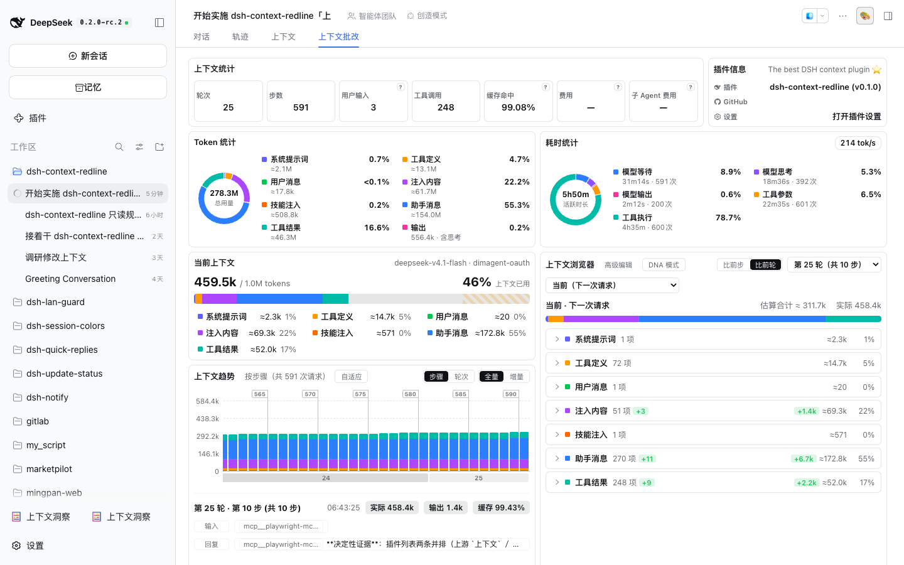

# dsh-context-redline（上下文批改）

> **DeepSeek Harness 插件**：把「上下文」从**只读的仪表盘**变成**人能批改的工作台** ——
> 看清模型即将收到什么 → **改其中一条** → 保存**只写插件本地** → 开启子会话时，把这些改动**逐字写进
> 那个新会话的第一句话**。

**当前状态：M1（骨架与身份）在仓库内已落地，尚未装进 profile。** 界面外壳从上游
[`dsh-context`](https://github.com/bowenliang123/dsh-context) 的 git tag **`v0.59.2`** 复制并整体改名成我们自己的命名空间；
编辑层（M2）与界面接线（M3）是下一步。**界面的准绳是 [`demo/`](demo/README.md)** —— 文档与它冲突时以它为准。

---

## 它要解决什么

| 问题 | 现象 | 本插件的答案 |
|---|---|---|
| **上下文膨胀** | 每次请求把全部历史重发，会话越跑越大 | **开子会话**：它继承「已经聊完的历史」（真正变短靠**显式压缩**，那一步在官方视图里做） |
| **一条写错的内容一直带着模型跑偏** | 上一轮话说得不清楚，后面全歪了 | **改那一条** → 保存（只存本地）→ **用它开子会话**：改动逐字进新会话第一句话 |
| **改不动** | 上游的上下文浏览器只能看，不能改 | **右侧直接编辑**：改哪一条、改了什么、改动去哪了，行上都写着 |

**一句话**：看上下文 → 改一条 → 保存（只在本地）→ **用改好的它开子会话**。

## 它长什么样


> ⚠️ 这张图来自仓库里的**交互 demo**（`demo/`，深色主题）—— 它是**当前界面的准绳**：
> 插件的界面按它实现。**插件的截图还没法给**：那要在 `dsh web` 重启后，在真面板上截
> （`docs/10` M3-22 的人工门禁）。把 demo 截图说成"插件截图"是这一版**唯一**容易被误读的地方，
> 所以这里明写。

五张卡，两列（以 [`demo/`](demo/README.md) 为准）：

- **左列**：上下文统计 · 上下文趋势（按轮次/按步骤、总计/增量、自适应刻度）· 上下文事件。
- **右列**：上下文浏览器（7 类，每类带条数 / ≈token / 占比 / 非零 δ）· 子会话。
- **行上**：`#seq` + 类别 + 预览，动作**只有 `编辑`**。平台改不了的行（助手消息、被压缩埋掉的、被遮蔽的原文）
  只给**一句原因、不给任何动作**。
- **编辑器**在**那一行下面内联展开**（不弹窗），预填的是**完整正文** —— 绝不是列表里那 80 字预览
  （早期那次尝试就是把它当正文，点一下把整条消息截成 80 字；见 [`docs/01`](docs/01-platform-facts.md) F35）。
- **所有保存都是临时保存**（硬约束）：只写插件本地，**当前会话的模型看不到**。有本地改动的行显示
  `已改（本地）` + `丢弃这条改动`；再点 `编辑` 预填的是**你上次保存的正文**，保存**覆盖同一条**（不叠加）。
- **唯一写入点是 `开启子会话`**：确认框列出本地改动，确认后逐字写进**新会话第一句话**。
  新会话**永远从"最后聊完的那一轮"开始**，**没有任何参数**能挑更早的位置
  （[`docs/01`](docs/01-platform-facts.md) F38）。



> ⚠️ 这张是**插件自己的真机截图**（`dsh web` 里的「上下文批改」页签，2026-10-04，会话 25 轮 / 591 步）：
> 页签读作 `对话 | 轨迹 | 上下文 | 上下文批改`（上游仍叫「上下文」，我们不再重名）；面板里能看到
> `高级编辑`、`比前步 / 比前轮`（默认**比前轮**按下）、两级选择器 `第 25 轮（共 10 步）`，以及分类行上的
> δ（`注入内容 +3` / `助手消息 +11` / `工具结果 +9`）。**界面准绳仍是交互 demo**（`demo/`）：
> 上一张说明"应该长什么样"，这一张说明"现在长这样"。

## 四条必须让人一眼明白的规则

1. **只有 surface 上的内容才进模型**。
2. **保存 ≠ 生效**：保存不碰会话日志，当前模型看到的东西不变；唯一写入点是**开启子会话**。
3. **哪些能改，由平台能力决定**（实测）：
   - 可改：**用户消息、注入内容、技能注入、工具结果**；
   - **改不了：助手消息**（平台两条规则互斥）与**系统提示词**；**被遮蔽的原文**与**被压缩埋掉的**也改不了；
   - 这些行一律给**一句原因、不给动作**，绝不出现"点了必然报错"的按钮。
4. 本界面**没有**版本历史、回滚、批注、固定块、漂移检查、重注入、压缩、派活或团队操作；
   编辑是**唯一的动作**，而且是**一步**（只存本地）。

## 明确不做

- ❌ 不做"删除历史"（DSH 的会话日志是 append-only；能做的只有**遮蔽**与**压缩**，后者不可逆）
- ❌ 不自动开子会话 / 不自动压缩 / 不自动提交本地改动
- ❌ 不产生任何 **AI 生成内容**（这是本项目存在的理由：进模型的每个字都必须来自人）
- ❌ 本轮不做"上下文装配/模板/组装"那一套（那是另一个数据模型，见 [`docs/00`](docs/00-scope.md) §4）

---

## 文档索引

| 文件 | 内容 |
|---|---|
| [`docs/00-scope.md`](docs/00-scope.md) | 目标 / 非目标 / 用户故事 / **可验收的成功标准** / 术语 |
| [`docs/01-platform-facts.md`](docs/01-platform-facts.md) | **平台事实清单**（每条带出处、标注"实测/推断"）+ 待验证项 |
| [`docs/02-architecture.md`](docs/02-architecture.md) | 五层架构、两条数据流、模块布局、RPC/命令/服务接口、存储 |
| [`docs/03-ui-spec.md`](docs/03-ui-spec.md) | **界面规格**（逐条编号，含文案、验收清单、明确不做的界面） |
| [`docs/04-roadmap.md`](docs/04-roadmap.md) | M0–M7 阶段表（产物 / 测试 / **谁能验收** / **授权点**） |
| [`docs/05-test-plan.md`](docs/05-test-plan.md) | 测试 lane、真实路由级测试模式、人工门禁清单、失败模式用例 |
| [`docs/06-orchestration.md`](docs/06-orchestration.md) | 子会话 / 压缩的语义、授权清单、失败码、明确不做 |
| [`docs/08-open-questions.md`](docs/08-open-questions.md) | **问题与裁定**（含推荐、理由与最终结论）+ **外部模型评审记录**（逐条采纳/不采纳） |
| [`docs/09-requirements-traceability.md`](docs/09-requirements-traceability.md) | **需求追溯矩阵**：你的原话与图 2/3/4 每一项 → 落在哪条目标 → 做/不做/降级 |
| [`demo/`](demo/README.md) | **可点击的交互原型**（M0.5 交互门禁）：假数据 + 真交互 + 「这个按钮是做什么的」讲解模式 |
| [`docs/12-user-guide.md`](docs/12-user-guide.md) | **用户向总体帮助**：这是什么 / 五分钟上手 / 七类能不能改 / 何时不能改 / 术语表 / 常见问题 |
| [`docs/11-session-handoff.md`](docs/11-session-handoff.md) | **换会话时的交接文本**：一段可复制粘贴的话 + 每次收尾要更新的字段（新会话先读它） |
| [`docs/10-execution-checklist.md`](docs/10-execution-checklist.md) | **长任务执行清单（唯一状态源）**：细粒度任务表 —— `ID / 子任务 / 状态 / 文件动作（范围冻结）`，共 272 项，需要你的那几步标 `WAIT🙋` |
| [`AGENTS.md`](AGENTS.md) | 工作约定（唯一必读入口）：硬约束、平台坑、测试纪律 |
| [`UPSTREAM.md`](UPSTREAM.md) / [`NOTICE`](NOTICE) | 上游来源、许可合规、我们的修改清单 |

> **编号说明**：`docs/07` 曾是"早期那次尝试"的审计文档，已于 2026-09-30 按用户要求**已删除**；**该编号不复用**，以免与历史引用混淆。

## 怎么读（给评审者）

1. 先读 [`docs/00-scope.md`](docs/00-scope.md) §2（非目标）与 §3（成功标准）——**判断"要建的东西对不对"**。
2. 再读 [`docs/01-platform-facts.md`](docs/01-platform-facts.md)——**判断"依据真不真"**（含 §6 明确的待验证项）。
3. 然后 [`docs/03-ui-spec.md`](docs/03-ui-spec.md) 与 [`docs/06-orchestration.md`](docs/06-orchestration.md)——**判断"人和不可逆动作的关系讲清楚了没有"**。
4. 最后 [`docs/08-open-questions.md`](docs/08-open-questions.md)——**直接对某条下结论**（每条都有编号）。

## 安装与使用

**还没有可安装的发布版**（下面的命令都是开发/自验循环）。两条硬规矩：
**把本仓库装进 `web` profile 需要你单独授权**；**重启 `dsh web` 一律由你本人执行**。

```bash
pnpm install                                   # 唯一的安装步骤 —— 不建符号链接（docs/01 F42）
./node_modules/.bin/tsc --noEmit               # 类型检查（含 tests/**）
./node_modules/.bin/tsdown                     # 构建 lib/（客户端半边 + 宿主半边）
node scripts/namespace-contract.mjs            # 11 个面 / 25 项：我们的命名空间 vs 上游的
./node_modules/.bin/oxlint                     # 风格与类型感知规则（必须 0 error）
./node_modules/.bin/vitest run --project edit --project channel --project client-logic --project client-ui
node scripts/progress.mjs                      # 只读：看到哪些已完成、哪些没完成（--all 全列）
node demo/check-static.mjs && node demo/check-runtime.mjs   # 交互 demo 的两条自检
```

**装进一个 profile（测试期，需授权）**：

```bash
dsh plugin --profile web add /绝对路径/dsh-context-redline   # 本地目录
# 发布到 npm 之后：dsh plugin --profile web add dsh-context-redline
```

装完**必须由你重启 `dsh web`**（本机这一步承载着你正在用的会话）。
**客户端改动只需硬刷新**，不必重启（[`docs/01`](docs/01-platform-facts.md) F16）。

**这条链的限制**（都是产品定义，不是待办）：
- **保存只写插件本地**，当前会话的模型看不到；只有**开启子会话**时才逐字带进新会话的第一句话。
- **助手消息 / 系统提示词 / 工具定义改不了**（平台硬限制与宿主保护，界面会写明原因）。
- 界面**不提供版本历史 / 回滚**（与"保存只到本地"冲突，见 [`docs/11`](docs/11-session-handoff.md) D19）。
## 许可

本项目自身为 **MIT**（[`LICENSE`](LICENSE)）；其中复制自上游 `dsh-context` 的部分为 **Apache-2.0**
（原文见 [`LICENSE-Apache-2.0`](LICENSE-Apache-2.0)，来源与修改清单见 [`UPSTREAM.md`](UPSTREAM.md)）。
本插件是独立 fork，**与上游作者无隶属关系**，也不代表其背书。

## 关于早期那次尝试

本仓库曾有一条基于上游 `v0.59.0` 的实现线（2026-09 期间），**其目录与 git 历史已丢失**，审计文档也已按用户要求删除。
本线以 tag `v0.59.2` 为基线重新复制；**只保留"别重犯"的结论**，写在 [`docs/01`](docs/01-platform-facts.md) 与 [`AGENTS.md`](AGENTS.md) §2。
