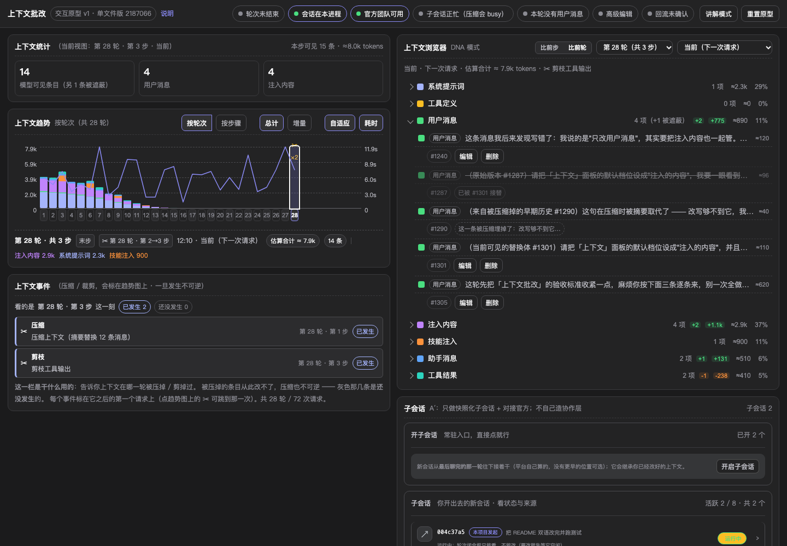
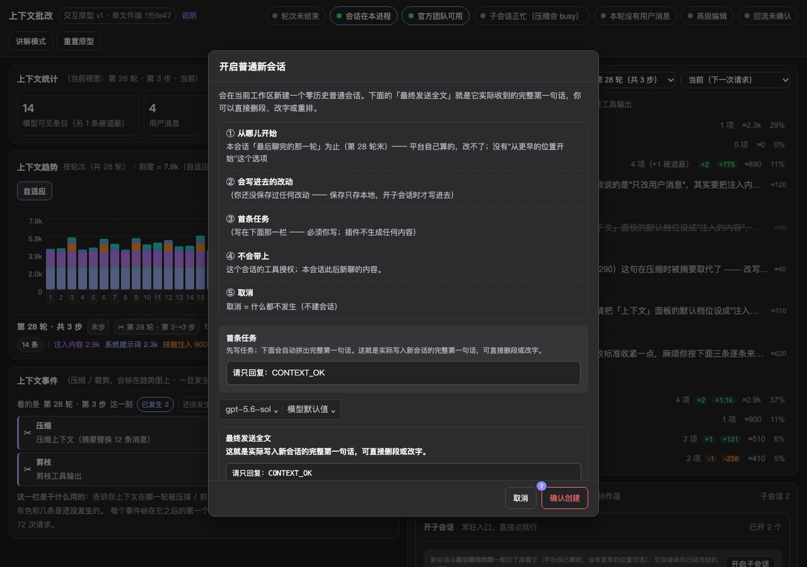
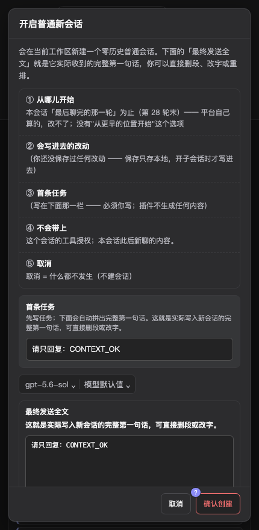

<h1 align="center">上下文批改 · Context Redline</h1>

<p align="center">查看、批改并迁移 DeepSeek Harness 会话上下文，再把任务结果原样送回来源会话。</p>

<p align="center">
  <a href="https://www.npmjs.com/package/dsh-context-redline"></a>
  <a href="https://github.com/idoall/dsh-context-redline/actions/workflows/ci.yml"></a>
  <a href="https://github.com/idoall/dsh-context-redline/blob/main/LICENSE"></a>
</p>

<p align="center"><a href="https://github.com/idoall/dsh-context-redline/blob/main/README.md">English</a> | 中文</p>

<p align="center">
  <a href="#能做什么">能做什么</a> ·
  <a href="#安装">安装</a> ·
  <a href="#使用">使用</a> ·
  <a href="#边界">边界</a> ·
  <a href="https://github.com/idoall/dsh-context-redline/blob/main/CHANGELOG.md">更新记录</a>
</p>

> DeepSeek Harness 社区插件。它不修改 DSH 源码，也不改写来源会话日志。
>
> **版本 `0.10.0` — 支持 DSH `>=0.2.3-alpha.2 <0.3.0-0`。** 使用 `0.2.3-alpha.2` 完成构建与回归测试；要求 Node.js `^24.22.3 || >=26.13.1`。不支持 DSH `0.3.0` 的预发布版本。

本地编辑只写插件目录；确认后，插件在当前工作区创建一个零历史普通会话，逐字发送你确认的最终全文。任务完成后，绑定结果自动回到来源会话。

<p align="center">
  
</p>

<p align="center"><sub>当前交互 demo 的桌面总览：左侧看规模与事件，右侧查看、编辑或删除迁移材料。</sub></p>

## 能做什么

- **全文查看。** 编辑器读取 durable 全文，不使用列表里的短预览。
- **本地批改。** 编辑用户消息、注入 / 技能材料、助手迁移副本和已配对工具结果。
- **可逆删除。** 删除表示“不迁移这条”，来源日志保持 append-only。
- **最终全文。** 确认框中的文本就是新会话收到的完整第一条用户消息，可直接删段、改字、重排。
- **交接技能。** 插件自带运行时技能 `context-redline-handoff`：读取当前对话，按需要给出两种交接内容——迁移方式（首条任务 + 每轮运行时规则锚点）或新建带规则对话的四段（首条任务、目标、验收标准、执行纪律），并强制拆任务（每个里程碑一个任务/子会话）、主会话/子会话分工与按需的有头 UAT。它还会每次都给出可选的「督导运行」整段内容，由用户决定要不要勾选：每任务四列（ID、标题、验收、必填的允许改动 scope）、探针命令，以及七项逐条带理由的选项建议：对话执行模型与推理等级、独立评估模型与推理等级、执行回退模型、评估回退模型、是否启用视觉取证（勾选时要选多模态 witness）、严格模式、独立 worktree（不会编造 provider/model 名称），并写明督导运行会自己提交打 tag、隔离 worktree 不会自动合回。
- **不迁移上下文的锚定会话。** 用一条首条任务加一套冻结的目标 / 验收标准 / 执行纪律，直接开一个独立的新对话；不搬当前上下文，也不把结果回传。
- **督导运行（0.9 Beta）。** 锚定会话可以勾选「督导运行」：确认过的目标、验收标准、执行纪律和任务表冻结进运行目录（`docs/guard/<run-id>/`），其中 `tasks.json` 是唯一事实源、`state.jsonl` 只追加、`TASKS.md` 是给人看的那一页。每轮结束插件自己审计：先跑该任务的确定性探针（**永远不由模型执行**），再由独立评估器（默认跟随主会话模型，也可在督导运行里另选独立评估模型获取第二意见）按冻结目标卡判定，通过后只提交该任务声明的路径加台账，并打 tag `guard/<run-id>/<task>`。首尾锚点每轮都从台账重新渲染，所以历史被压缩也不会与实际在跑的任务脱节。长跑不会撞上宿主的 256 轮默认上限：插件建 goal 时自带大轮次预算，并在仍有进展、余量见底时自动续期；反过来，探针全过却连续多轮既无代码改动也无新完成声明的任务会被判定空转并自动置为阻塞，把轮次留给真正的推进。卡片同时读取台账与宿主 goal 的实时状态：宿主目标因轮次上限或未激活而停下时，卡片如实显示「已阻塞/已暂停」并给出「继续运行」，不再把死掉的运行显示成「进行中」。严格模式会额外拒绝 scope 外写入和一切 shell 工具。**模型角色拆分为执行与评估两条链，各自可设主模型与回退模型（都带推理等级）**：评估器遇到空回复、超时、限流等可按失败码切到回退模型并写 `eval.fallback` 留痕；额度/鉴权类错误只报清楚，跨 provider 的额度不足才允许切换。运行阻塞时卡片提供「继续运行」「换执行回退模型并继续」「换评估回退模型并继续」。可选的**视觉取证**只做观察：把本任务新增/修改的截图交给视觉模型列出问题，由文本评估器裁决；witness 不可用时视觉类验收最多 `insufficient`，绝不据此通过。任务阻塞时整轮停下并保留补丁作为证据；回退会重开该任务，且需要点两次确认。已知边界是写明的而非暗示的：并行任务共享同一个运行 worktree、隔离 worktree 不会自动合回，而且这套机制的可信度取决于你给它的探针有多硬。
- **DNA 指纹模式。** 趋势柱可切换为按模型读取顺序的逐条色带；浏览器的 DNA 开关与趋势开关联动。DNA 模式当前固定为总计语义。
- **趋势耗时曲线。** 每根趋势柱叠加该步的活跃耗时曲线，读右侧刻度；按轮次时把该轮各步相加。自适应与耗时合并为一组紧凑开关，聚焦分类的旧副标题已移除。
- **锚点两种生效方式。** 可选的一小段锚点（你自己写的关键词或硬约束）可以放在首条消息首尾，也可以作为每轮运行时规则。运行时规则使用 DSH 的运行时上下文快照：文本不变时不重复写入，压缩后会带“取代旧版本”声明重新声明。两种方式都不改预设拥有的系统提示词，也不改来源会话。
- **会话级模型。** 一行浮动选择器配置新会话模型和推理等级，不修改来源会话或全局默认。
- **普通新会话。** 在当前工作区创建零历史 root session，不继承 fork 历史。
- **自动回程。** 只取与固定 prompt request ID 绑定的结果，原样送回来源会话。
- **可恢复。** 固定 ID、持久台账、精确正文匹配、flush、冷读和三态恢复共同防止重复或猜测。

<p align="center">
  
</p>

<p align="center"><sub>桌面确认框：任务、模型 / 推理等级和最终发送全文在一次明确授权中冻结。</sub></p>

<p align="center">
  
</p>

<p align="center"><sub>移动端确认框：选择器保持一行，长内容只在最终全文框内滚动。</sub></p>

> 截图来自仓库当前版本的交互 demo，用于说明布局与关键流程，不冒充生产会话数据。

## 安装

需要 DeepSeek Harness `0.2.3-alpha.2` 或更新且受支持的 `0.2.x`，以及 Node.js `24.22.3+`（26.x 系列为 `26.13.1+`）。旧版 DSH 请先使用插件 `0.8.4`，升级 DSH 后再更新插件。

安装或升级到本次确切版本：

```sh
dsh plugin --profile web add dsh-context-redline@0.10.0
```

本次让「只观察」的守卫真正能当进度信号，并加入第一层「短锚点」。守卫不再因为主会话写自己的计划 / 审查记录就短路：每轮都跑评估器，并把写入的路径（不只是工具计数）交给它判断，判定通过就推进任务台账；卡片在「这次没评估」时写明原因，而不是一直挂着旧的失败。同时在完整目标卡之外，把一小段**必须不走样的不变量**重新注入到每轮提示的开头和结尾——目标 hash、当前任务与验收、硬规则、停止条件，状态来自实时台账——让关键约束躲过上下文窗口与压缩。守卫仍然只观察。

本地开发：

```sh
pnpm install
pnpm run build
dsh plugin --profile web add "link:$(pwd)"
```

安装或宿主代码更新后，由用户本人重启 `dsh web`。仅客户端改动构建后通常只需硬刷新。

卸载：

```sh
dsh plugin --profile web remove dsh-context-redline
```

卸载插件不会自动删除 `$DSH_HOME/dsh-context-redline/` 中的本地草稿和操作台账。

## 使用

1. 打开已有消息的会话，进入「上下文批改」。
2. 可选：逐条编辑或删除；保存只写本地。
3. 点击「开启普通新会话」。
4. 不确定填什么时，先执行 `context-redline-handoff` 技能；它会推荐迁移还是新建带规则对话，强制拆出任务清单并为每个任务派子会话，判断是否需要做有头 UAT，并给出对应字段。锚定会话的标题直接用目标，不再加“新对话”前缀。
5. 迁移流程里填写任务；可选填写一小段锚点（关键词或硬约束）并选择「放在首条消息」或「每轮运行时规则」，再在「最终发送全文」中完成最后修改。
6. 选择模型；推理等级可保持「使用模型默认值」。在锚定会话中可选开启 **督导运行**：粘贴四列任务表与探针命令；勾选后「对话执行模型」会移进选项区并排在「执行回退模型」之前（未勾选时仍在下方运行配置里），再按需另选独立评估模型、执行/评估回退模型，决定是否启用视觉取证（勾了要选多模态 witness）、严格模式或独立 worktree（在当前工作区的 `.guard/worktrees/<runId>` 建隔离检出、分支 `guard/<runId>`，该目录本地忽略不入提交，且**不注册新的 DSH 工作区**——新会话仍归当前工作区，只有运行目录切到隔离检出）。**检测到 git 仓库时会默认勾选独立 worktree**（可取消）；在默认分支上取消会给出「提交会落在 `main`」的警告。
7. 确认创建；在左侧打开新会话。
8. 迁移流程里，新会话结束后结果会自动回到来源会话。

详见[用户指南](https://github.com/idoall/dsh-context-redline/blob/main/docs/12-user-guide.md)。

## 图片和附件

- 混合文字 / 图片消息迁移全部文字，并显示「图片 N 个未迁移」。
- 纯图片消息不生成空白段，但计入遗漏数。
- 图片引用仍参与来源指纹，图片变化会使旧确认失效。
- 图片二进制、文件、file-ref 和通用附件当前不迁移；未知媒体明确拒绝，不会静默消失。

## 边界

- 不改写或删除来源会话历史。
- 系统提示词和工具定义由目标预设生成；迁移文字不冒充系统层。
- 工具结果必须匹配原工具调用。
- 不提供历史版本、回滚、压缩、团队任务板或会话删除 UI。
- 督导运行的「严格模式」是**默认关闭**的：只有勾选并确认后才会拒绝 scope 外写入与 shell 工具；不勾选时它只记录，行为等同观察模式。
- 插件保证自身锁内幂等与可恢复，不宣称平台天然 exactly-once。

## 开发

```sh
pnpm install
pnpm run typecheck
pnpm run lint
pnpm run test
./node_modules/.bin/vitest run
node scripts/release-check.mjs
pnpm pack --dry-run
```

推送 `v*` tag 后，GitHub Actions 会校验版本和双语发布说明、测试、打包，并通过 npm Trusted Publishing（OIDC，无 `NPM_TOKEN`）发布，再创建 GitHub Release。

## 文档

- [用户指南](https://github.com/idoall/dsh-context-redline/blob/main/docs/12-user-guide.md)
- [上下文迁移合同](https://github.com/idoall/dsh-context-redline/blob/main/docs/13-context-migration.md)
- [系统提示词与注入边界](https://github.com/idoall/dsh-context-redline/blob/main/docs/14-system-prompt-and-injection.md)
- [承载会话生命周期](https://github.com/idoall/dsh-context-redline/blob/main/docs/15-carrier-lifecycle.md)
- [督导运行设计](https://github.com/idoall/dsh-context-redline/blob/main/docs/17-goal-supervisor-design.md)
- [上游来源与修改记录](https://github.com/idoall/dsh-context-redline/blob/main/UPSTREAM.md)

## 许可

原创部分采用 MIT；复制自 `dsh-context` 的部分保留 Apache-2.0。详见 [LICENSE](https://github.com/idoall/dsh-context-redline/blob/main/LICENSE)、[LICENSE-Apache-2.0](https://github.com/idoall/dsh-context-redline/blob/main/LICENSE-Apache-2.0)、[NOTICE](https://github.com/idoall/dsh-context-redline/blob/main/NOTICE) 和 [UPSTREAM.md](https://github.com/idoall/dsh-context-redline/blob/main/UPSTREAM.md)。本插件是独立 fork，不代表上游作者背书。
